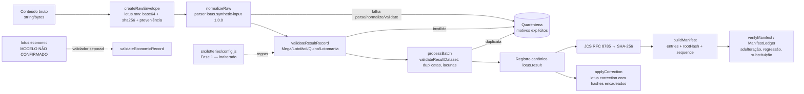

# LOTUS — Fase 3a: Fundação de Dados, Integridade e Validação

> **SYNTHETIC_DATA.** Todos os dados usados nesta fase são **artificiais** (fixtures escritas à mão e sorteios do laboratório sintético da Fase 2). Nenhum dado real, nenhuma chamada à CAIXA ou a qualquer rede, nenhuma assinatura digital, nenhuma chave. Os nomes de campos são **internos do LOTUS** e **não** representam contratos oficiais; o mapeamento de fontes reais é da Fase 3b.

Branch: `phase-3a-data-foundation` (a partir de `main` = `faca405eb1b6ca25d69cfd84ccf5601fee8b0136`). Node ≥ 20, **zero dependências**, testes com `node:test`, ESM. Documento gerado em 2026-11-03 (America/Sao_Paulo, UTC−03:00) com Node v24.22.1.

## 1. Objetivo
Criar a base offline, testável e reproduzível para receber resultados de concursos na Fase 3b: modelo canônico separado (resultado × economia), preservação do bruto, normalização determinística, validação por modalidade, quarentena com motivo explícito, trilha de correções, canonicalização JSON RFC 8785, SHA-256 e manifesto de integridade com proteção contra regressão/substituição de versão.

## 2. Arquitetura


```
src/integrity/jcs.js        RFC 8785: números (Number::toString, -0→0, NaN/Inf rejeitados), strings, ordenação UTF-16, detecção de chave duplicada
src/integrity/hash.js       SHA-256 síncrono (node:crypto) + assíncrono (WebCrypto, compatível com navegador/PWA); hashJson = SHA-256(UTF-8(JCS))
src/integrity/manifest.js   manifesto lotus.manifest 1.0.0, verificação, checkSuccession, ManifestLedger
src/integrity/index.js      reexportações
src/data/schema.js          nomes/versões de esquema; LOTTERY_IDS e regras vindas de src/lotteries/config.js
src/data/raw.js             envelope bruto lotus.raw (bytes exatos em base64 + sha256 + proveniência)
src/data/normalize.js       normalizador determinístico e processBatch (aceito OU quarentena — nunca descarte)
src/data/quarantine.js      entradas imutáveis com estágio e motivos; QuarantineStore somente-acréscimo
src/data/correction.js      correções com valor anterior/novo, fonte, data, motivo, autor e hashes antes/depois
src/data/index.js           reexportações
src/validation/common.js    erros estruturados, datas ISO, proveniência, política de campos desconhecidos (rejeitar)
src/validation/result.js    validadores por modalidade
src/validation/economic.js  validador do modelo econômico interno (não confirmado)
src/validation/dataset.js   duplicidade de concurso, lacunas (informativas), ordem de datas (aviso)
src/validation/index.js     reexportações
scripts/reprodutibilidade-fase3a.mjs  pipeline completo executado duas vezes, compara hashes
test/fase3a/*.test.js       41 testes novos
test/fase3a/fixtures/SYNTHETIC_DATA/  fixtures sintéticas (nomes começam com SYNTHETIC_DATA_)
test/fase3a/vectors/        vetores independentes (RFC 8785 Apêndice B; cyberphone/json-canonicalization)
docs/fase3a-evidencias/     saídas reais de teste e registro de reprodutibilidade
```
Arquivo existente modificado: **somente `package.json`** (scripts `test` passa a incluir `test/fase3a/*.test.js`; novos `test:fase3a` e `reprodutibilidade:fase3a`). `src/math`, `src/lotteries`, `src/sim`, `src/stats`, `src/lab.js` e testes antigos **não foram alterados**.

## 3. Modelo de dados (nomes internos LOTUS)
**A. Resultado — `lotus.result` 1.0.0:** `schema`, `schemaVersion`, `lottery` (`megasena|lotofacil|quina|lotomania`), `contest` (inteiro ≥ 1), `drawDate` (`AAAA-MM-DD` válida), `numbers` (inteiros distintos em ordem crescente), `provenance`.
**B. Economia — `lotus.economic` 1.0.0, `modelStatus: "UNCONFIRMED_INTERNAL_MODEL"`:** `lottery`, `contest`, `tiers[] {hits, winners, prizePerWinnerCents}`, `totalCollectedCents` (string de centavos ou `null` quando não houver fonte confiável), `provenance`. Registro **separado** do resultado (o validador de resultado rejeita um registro econômico e vice-versa). Faixas só podem ser as de `prizeTiers` da config da Fase 1. Somente esquema + validador: não há dados econômicos reais.
**Proveniência:** `sourceType` ∈ {`SYNTHETIC_DATA`, `MANUAL_ENTRY`, `EXTERNAL_UNVERIFIED`}, `sourceId`, `obtainedAt` (ISO UTC fornecido), `note` opcional. Os dois últimos tipos existem apenas para a 3b; nenhuma fonte real foi avaliada.
**Estado de validação:** fica no envelope de processamento (`status`, `validation`, `parserVersion`, `rawSha256`, `recordSha256`), **não** dentro do registro hasheado — porque depende da versão do validador, não do dado.

## 4. Decisões e justificativas
1. **Reuso da config da Fase 1** (`getLottery`) para quantidade e intervalos; os testes conferem as regras contra valores literais independentes (6/1..60, 15/1..25, 5/1..80, 20/0..99) — evita duplicação e detecta divergência.
2. **Campos desconhecidos são rejeitados** (`UNKNOWN_FIELD`): mais seguro para dados de integridade; versões futuras do esquema devem ser explícitas.
3. **Bruto preservado em bytes** (base64) com SHA-256; adulteração do envelope leva a quarentena `RAW_INTEGRITY`.
4. **Normalização mínima e documentada**: dezenas `"07"`→7, ordenação, `DD/MM/AAAA`→ISO, concurso em texto de dígitos→inteiro. O formato de entrada `lotus.synthetic-input/1` é interno e só serve às fixtures.
5. **Nada é descartado**: `processBatch` lança erro se `aceitos + quarentena ≠ entrada`. Duplicatas de concurso (idênticas ou conflitantes) vão para quarentena no estágio `dataset`; a primeira ocorrência é mantida (política provisória, a revisar na 3b).
6. **Lacunas de numeração** são apenas informadas (`gaps`), pois um conjunto pode ser parcial.
7. **JCS próprio** (sem dependência): números via `String(n)` (ECMAScript Number::toString, exigido pela RFC), surrogates isolados e chaves duplicadas rejeitados (I-JSON), ordenação por unidades UTF-16 explícita.
8. **SHA-256** via `node:crypto`, com versão WebCrypto equivalente (testada) para futura execução em navegador/PWA.
9. **Manifesto sem relógio oculto**: `createdAt` é parâmetro obrigatório. `rootHash` = SHA-256(JCS(manifesto sem rootHash)). `sequence` deve crescer estritamente por `datasetId`; sequência menor → `SEQUENCE_REGRESSION`; igual com hash diferente → `SEQUENCE_SUBSTITUTION`; igual com mesmo hash → `SEQUENCE_REPLAY_IDENTICAL` (não avança). Sem assinatura digital (fora do escopo).
10. **Dinheiro em centavos como string** de dígitos para evitar ponto flutuante.

## 5. Vetores independentes
- **RFC 8785** (texto obtido de https://www.rfc-editor.org/rfc/rfc8785.txt): exemplo das §3.2.2/§3.2.3 e os **26** vetores do Apêndice B (bits IEEE 754 → JSON, incluindo NaN/Infinity, que devem ser rejeitados), extraídos para `test/fase3a/vectors/rfc8785-appendix-b.json`.
- **cyberphone/json-canonicalization** `testdata/input|output` (6 pares), commit `32a48195b9b20fe67b1795e39e4509f14d860b45`, Apache-2.0, com `LICENSE` e `ATTRIBUTION.md`. Comparação **byte a byte** da saída UTF-8.
- **SHA-256 (NIST)**: `""`, `"abc"` e a mensagem de 448 bits `abcdbcdecdef…nopq`.

## 6. Testes (execução real em 2026-11-03, Node v24.22.1)
| Comando | Resultado |
|---|---|
| `npm run test:fase1` | 88/88 |
| `npm run test:fase2` | 80/80 |
| `npm run test:fase3a` | 41/41 (compat 3, data 9, economic 2, jcs 8, manifest 5, sha256 3, validation 11) |
| `npm test` | **209/209** (168 anteriores + 41 novos), 0 falhas, 0 ignorados |

Baseline antes de qualquer alteração (checkout limpo de `origin/main` `faca405`): `npm test` = 168/168.
Saídas completas: `docs/fase3a-evidencias/test-output.txt` e `test-output-fase3a.txt`.

## 7. Reprodutibilidade
`npm run reprodutibilidade:fase3a` executa o pipeline (fixtures → bruto → normalização → validação → manifesto) duas vezes no mesmo processo e grava `docs/fase3a-evidencias/reprodutibilidade.json`; o arquivo foi gerado também em dois processos separados e comparado com `cmp` (idêntico). Resultado: 9 registros aceitos, 14 em quarentena, `rootHash` `2798516f61d0879083a301cf858da1af2d04c2163d6410c48004dd1fe8feacb9` nas duas execuções, verificação do manifesto OK. Os SHA-256 de cada fixture estão no mesmo arquivo.

## 8. Limitações conhecidas
- Formato de entrada aceito é apenas o sintético interno; nenhum parser de fonte real existe.
- Modelo econômico **não confirmado**; faixas/valores reais e regras de arrecadação dependem de fonte oficial (3b).
- Quarentena e ledger de manifestos são **em memória**; persistência não implementada.
- A verificação de chaves duplicadas em JSON é léxica e mínima (adequada a entradas JSON válidas).
- Sem assinatura digital: o manifesto detecta alteração acidental ou inconsistente, mas **não** autentica a origem (um adversário pode recalcular hashes).
- Datas: valida calendário gregoriano; não verifica se a data é dia de sorteio real.
- Política de duplicata "primeira ocorrência vence" é provisória.

## 9. Reservado para a Fase 3b
Escolha e validação de fontes oficiais, limites de acesso, parsers reais e mapeamento de campos, importação de histórico, dados econômicos reais, persistência, automação/agendamento, assinatura e gestão de chaves, publicação de dados — tudo **fora** desta fase.

## 10. Pontos para revisão independente
1. Conformidade JCS em casos extremos além dos vetores (ex.: strings com surrogates válidos em chaves, números subnormais).
2. Política de rejeição de campos desconhecidos e de duplicatas.
3. Adequação do formato do manifesto e das regras de sequência para a 3b.
4. Separação resultado × economia e nomes internos dos campos.
5. Escopo da normalização (o que é aceitável converter automaticamente).
