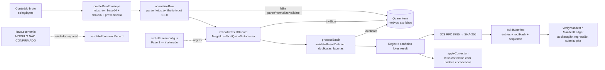

# LOTUS — Fase 3a: Fundação de Dados, Integridade e Validação

> **SYNTHETIC_DATA.** Todos os dados usados nesta fase são **artificiais** (fixtures escritas à mão e sorteios do laboratório sintético da Fase 2). Nenhum dado real, nenhuma chamada à CAIXA ou a qualquer rede, nenhuma assinatura digital, nenhuma chave. Os nomes de campos são **internos do LOTUS** e **não** representam contratos oficiais; o mapeamento de fontes reais é da Fase 3b.

Branch: `phase-3a-data-foundation` (a partir de `main` = `faca405eb1b6ca25d69cfd84ccf5601fee8b0136`). Node ≥ 20, **zero dependências**, testes com `node:test`, ESM. Documento gerado em 2026-11-03 (America/Sao_Paulo, UTC−03:00) com Node v24.22.1.

## 1. Objetivo
Criar a base offline, testável e reproduzível para receber resultados de concursos na Fase 3b: modelo canônico separado (resultado × economia), preservação do bruto, normalização determinística, validação por modalidade, quarentena com motivo explícito, trilha de correções, canonicalização JSON RFC 8785, SHA-256 e manifesto de integridade com proteção contra regressão/substituição de versão.

## 2. Arquitetura


```
src/integrity/jcs.js        RFC 8785: números (Number::toString, -0→0, NaN/Inf rejeitados), strings, ordenação UTF-16, detecção de chave duplicada
src/integrity/sha256-web.js  SHA-256 PORTÁVEL: sem imports node:*, WebCrypto assíncrono (sha256HexAsync, hashJsonAsync), toBytes, isSha256Hex
src/integrity/sha256-node.js SHA-256 SÍNCRONO só para Node (node:crypto): sha256Hex, hashJson — hashes idênticos aos da camada portável
src/integrity/hash.js        fachada NODE que reexporta as duas (API original preservada) — depende de node:crypto
src/integrity/manifest.js   manifesto lotus.manifest 1.0.0, validateManifestStructure, verifyManifest(Detailed), checkSuccession, ManifestLedger
src/integrity/index.js      reexportações
src/data/schema.js          nomes/versões de esquema; LOTTERY_IDS e regras vindas de src/lotteries/config.js
src/data/raw.js             envelope bruto lotus.raw (bytes exatos em base64 + sha256 + proveniência + envelopeSha256), verifyRawEnvelope(Detailed)
src/data/normalize.js       normalizador determinístico e processBatch (aceito OU quarentena — nunca descarte)
src/data/quarantine.js      entradas profundamente imutáveis (cópia defensiva + deepFreeze); QuarantineStore somente-acréscimo, armazenamento privado
src/data/correction.js      correções validadas (validateCorrection) com valor anterior/novo, fonte, data, motivo, autor, hashes antes/depois e correctionSha256
src/data/index.js           reexportações
src/validation/common.js    erros estruturados, datas ISO, proveniência, política de campos desconhecidos (rejeitar)
src/validation/result.js    validadores por modalidade
src/validation/economic.js  validador do modelo econômico interno (não confirmado)
src/validation/dataset.js   duplicidade de concurso, lacunas (informativas), ordem de datas (aviso)
src/validation/index.js     reexportações
scripts/reprodutibilidade-fase3a.mjs  pipeline completo executado duas vezes, compara hashes
test/fase3a/*.test.js       124 testes (41 originais + 83 das correções da auditoria, em audit-*.test.js)
test/fase3a/fixtures/SYNTHETIC_DATA/  fixtures sintéticas (nomes começam com SYNTHETIC_DATA_)
test/fase3a/vectors/        vetores independentes (RFC 8785 Apêndice B; cyberphone/json-canonicalization)
docs/fase3a-evidencias/     saídas reais de teste e registro de reprodutibilidade
```
Arquivo existente modificado: **somente `package.json`** (scripts `test` passa a incluir `test/fase3a/*.test.js`; novos `test:fase3a` e `reprodutibilidade:fase3a`). `src/math`, `src/lotteries`, `src/sim`, `src/stats`, `src/lab.js` e testes antigos **não foram alterados**.

## 3. Modelo de dados (nomes internos LOTUS)
**A. Resultado — `lotus.result` 1.0.0:** `schema`, `schemaVersion`, `lottery` (`megasena|lotofacil|quina|lotomania`), `contest` (inteiro ≥ 1), `drawDate` (`AAAA-MM-DD` válida), `numbers` (inteiros distintos em ordem crescente), `provenance`.
**B. Economia — `lotus.economic` 1.0.0, `modelStatus: "UNCONFIRMED_INTERNAL_MODEL"`:** `lottery`, `contest`, `tiers[] {hits, winners, prizePerWinnerCents}`, `totalCollectedCents` (string de centavos ou `null` quando não houver fonte confiável), `provenance`. Registro **separado** do resultado (o validador de resultado rejeita um registro econômico e vice-versa). Faixas só podem ser as de `prizeTiers` da config da Fase 1. Somente esquema + validador: não há dados econômicos reais.
**Proveniência:** `sourceType` ∈ {`SYNTHETIC_DATA`, `MANUAL_ENTRY`, `EXTERNAL_UNVERIFIED`}, `sourceId`, `obtainedAt` (ISO UTC fornecido), `note` opcional. Os dois últimos tipos existem apenas para a 3b; nenhuma fonte real foi avaliada.
**Estado de validação:** fica no envelope de processamento (`status`, `validation`, `parserVersion`, `rawSha256`, `recordSha256`), **não** dentro do registro hasheado — porque depende da versão do validador, não do dado.

## 4. Decisões e justificativas
1. **Reuso da config da Fase 1** (`getLottery`) para quantidade e intervalos; os testes conferem as regras contra valores literais independentes (6/1..60, 15/1..25, 5/1..80, 20/0..99) — evita duplicação e detecta divergência.
2. **Campos desconhecidos são rejeitados** (`UNKNOWN_FIELD`): mais seguro para dados de integridade; versões futuras do esquema devem ser explícitas.
3. **Bruto preservado em bytes** (base64) com SHA-256; adulteração do envelope leva a quarentena `RAW_INTEGRITY`.
4. **Normalização mínima e documentada**: dezenas `"07"`→7, ordenação, `DD/MM/AAAA`→ISO, concurso em texto de dígitos→inteiro. O formato de entrada `lotus.synthetic-input/1` é interno e só serve às fixtures.
5. **Nada é descartado**: `processBatch` lança erro se `aceitos + quarentena ≠ entrada`. Duplicatas de concurso (idênticas ou conflitantes) vão para quarentena no estágio `dataset`; a primeira ocorrência é mantida (política provisória, a revisar na 3b).
6. **Lacunas de numeração** são apenas informadas (`gaps`), pois um conjunto pode ser parcial.
7. **JCS próprio** (sem dependência): números via `String(n)` (ECMAScript Number::toString, exigido pela RFC), surrogates isolados e chaves duplicadas rejeitados (I-JSON), ordenação por unidades UTF-16 explícita.
8. **SHA-256** separado em camada portável (`sha256-web.js`, WebCrypto, sem `node:*` — verificado por teste automatizado que varre o grafo de importações) e implementação síncrona do Node (`sha256-node.js`). Isso **não** comprova compatibilidade completa com PWA; apenas remove a dependência do Node da camada portável. **Escopo exato:** só `sha256-web.js` é a camada de hash portável para navegador. `sha256-node.js` e a fachada `hash.js` são Node. Toda a cadeia de ingestão — `raw.js`, `normalize.js`, `manifest.js`, `correction.js` (e `quarantine.js` via esses fluxos) — usa o hash síncrono pela fachada Node e, portanto, **NÃO é declarada compatível com navegador/PWA** nesta fase. Uma versão assíncrona dessa cadeia não foi feita (fora do escopo).
9. **Manifesto sem relógio oculto**: `createdAt` é parâmetro obrigatório. `rootHash` = SHA-256(JCS(manifesto sem rootHash)). `sequence` deve crescer estritamente por `datasetId`; sequência menor → `SEQUENCE_REGRESSION`; igual com hash diferente → `SEQUENCE_SUBSTITUTION`; igual com mesmo hash → `SEQUENCE_REPLAY_IDENTICAL` (não avança). Sem assinatura digital (fora do escopo).
10. **Dinheiro em centavos como string** de dígitos para evitar ponto flutuante.

## 5. Vetores independentes
- **RFC 8785** (texto obtido de https://www.rfc-editor.org/rfc/rfc8785.txt): exemplo das §3.2.2/§3.2.3 e os **26** vetores do Apêndice B (bits IEEE 754 → JSON, incluindo NaN/Infinity, que devem ser rejeitados), extraídos para `test/fase3a/vectors/rfc8785-appendix-b.json`.
- **cyberphone/json-canonicalization** `testdata/input|output` (6 pares), commit `32a48195b9b20fe67b1795e39e4509f14d860b45`, Apache-2.0, com `LICENSE` e `ATTRIBUTION.md`. Comparação **byte a byte** da saída UTF-8.
- **SHA-256 (NIST)**: `""`, `"abc"` e a mensagem de 448 bits `abcdbcdecdef…nopq`.

## 6. Testes (execução real em 2026-11-03, Node v24.22.1)
| Comando | Resultado |
|---|---|
| `npm run test:fase1` | 88/88 |
| `npm run test:fase2` | 80/80 |
| `npm run test:fase3a` | 172/172 — originais 41 (compat 3, data 9, economic 2, jcs 8, manifest 5, sha256 3, validation 11) + auditoria 83 (manifest 32, raw-envelope 16, hash-split 3, quarantine 4, correction 28) + revisão complementar 48 (manifest-consistency 2, mediatype 16, quarantine-json 30) |
| `npm test` | **340/340** (88 + 80 + 172), 0 falhas, 0 ignorados |

Primeira entrega do PR (antes da auditoria): `npm test` = 209/209 (168 + 41). Após a auditoria: 292/292. Nenhum dos 41 testes originais foi alterado, removido ou ignorado (`git diff 4adba7e` vazio nesses arquivos).

Baseline antes de qualquer alteração (checkout limpo de `origin/main` `faca405`): `npm test` = 168/168.
Saídas completas: `docs/fase3a-evidencias/test-output.txt` e `test-output-fase3a.txt`.

## 7. Reprodutibilidade
`npm run reprodutibilidade:fase3a` executa o pipeline (fixtures → bruto → normalização → validação → manifesto) duas vezes no mesmo processo e grava `docs/fase3a-evidencias/reprodutibilidade.json`; o arquivo foi gerado também em dois processos separados e comparado com `cmp` (idêntico). Resultado: 9 registros aceitos, 14 em quarentena, `rootHash` `2798516f61d0879083a301cf858da1af2d04c2163d6410c48004dd1fe8feacb9` nas duas execuções, verificação do manifesto OK. Os SHA-256 de cada fixture estão no mesmo arquivo.

## 8. Limitações conhecidas
- Formato de entrada aceito é apenas o sintético interno; nenhum parser de fonte real existe.
- Modelo econômico **não confirmado**; faixas/valores reais e regras de arrecadação dependem de fonte oficial (3b).
- Quarentena e ledger de manifestos são **em memória**; persistência não implementada.
- A verificação de chaves duplicadas em JSON é léxica e mínima (adequada a entradas JSON válidas).
- Sem assinatura digital: manifesto, `envelopeSha256` e `correctionSha256` detectam alteração em relação ao que foi registrado, mas **não** autenticam a origem nem a autoria; um adversário que recalcule todos os hashes não é detectado localmente (há testes que documentam esse limite).
- A camada portável de SHA-256 não foi executada em navegador real nesta fase; só se verifica que ela não importa `node:*`.
- A cadeia de ingestão (bruto, normalização, manifesto, correção) depende da fachada Node `hash.js` e **não** é compatível com navegador/PWA nesta fase.
- O teste de consistência do manifesto é do tipo propriedade com gerador determinístico (2000 casos); não é prova formal.
- `envelopeSha256` não entra no manifesto de reprodutibilidade (o manifesto cobre registros normalizados e arquivos).
- Datas: valida calendário gregoriano; não verifica se a data é dia de sorteio real.
- Política de duplicata "primeira ocorrência vence" é provisória.

## 9. Reservado para a Fase 3b
Escolha e validação de fontes oficiais, limites de acesso, parsers reais e mapeamento de campos, importação de histórico, dados econômicos reais, persistência, automação/agendamento, assinatura e gestão de chaves, publicação de dados — tudo **fora** desta fase.

## 10. Pontos para revisão independente
1. Conformidade JCS em casos extremos além dos vetores (ex.: strings com surrogates válidos em chaves, números subnormais).
2. Política de rejeição de campos desconhecidos e de duplicatas.
3. Adequação do formato do manifesto e das regras de sequência para a 3b.
4. Separação resultado × economia e nomes internos dos campos.
5. Escopo da normalização (o que é aceitável converter automaticamente).

## 11. Correções da auditoria independente (PR #3)
1. **Manifesto — validação estrutural completa (bloqueante).** `validateManifestStructure` verifica campos obrigatórios/desconhecidos, `datasetId` (formato), `dataSchemaVersion`, `sequence` (inteiro seguro ≥ 1), `createdAt` (UTC válido), `entries` (array não vazio), cada entrada (objeto simples, `id` string não vazia, `kind` ∈ {record, file}, `sha256` com 64 hex minúsculos, sem campos extras), ids únicos e ordem UTF-16 estrita, `rootHash` com formato válido. `verifyManifestDetailed` devolve `{ok, structuralOk, hashOk, errors}` sem lançar; `verifyManifest` mantém o formato original `{ok, errors}`. `ManifestLedger.submit` rejeita todos os casos exigidos **mesmo com rootHash recalculado** (30 casos forjados testados).
2. **Envelope bruto completo (bloqueante).** Novo `envelopeSha256` = SHA-256(JCS(envelope sem esse campo)), cobrindo schema, versão, mediaType, byteLength, sha256 dos bytes, conteúdo e proveniência. `verifyRawEnvelopeDetailed` valida estrutura, proveniência, base64, bytes/byteLength/sha256 e envelopeSha256; a normalização coloca em quarentena (`RAW_INTEGRITY` + motivos detalhados) qualquer envelope que falhe. Testada a adulteração isolada de sourceType, sourceId, obtainedAt, note, mediaType, schema, schemaVersion, contentBase64, byteLength, sha256, envelopeSha256 e campo extra.
3. **SHA-256 portável × Node.** Ver decisão 8. Testes de equivalência (strings, bytes, JSON) e varredura automática de importações (com controle positivo).
4. **Quarentena imutável de verdade.** Cópia profunda (`structuredClone`) na criação, no `add` (que revalida) e em `list`/`byCode`; congelamento profundo seguro para ciclos; armazenamento em campo privado `#entries`. Testes tentam mutar candidato, arrays, motivos e objetos aninhados, por referência externa e pela saída de `list()`.
5. **Correções.** `validateCorrection` (schema/versão, modalidade, concurso, campo na lista permitida, textos de source/reason/actor, data UTC, formato dos três hashes, ausência de mudança, campos extras) e `correctionSha256`; `replayCorrections` verifica tudo isso, mais modalidade/concurso iguais ao registro, encadeamento, previousValue, validade do resultado e resultSha256. Testada a adulteração de source, date, reason, actor, field, previousValue, newValue, targetSha256, resultSha256 (e outros), com e sem recálculo do hash próprio.

Mudanças de comportamento a observar: `QuarantineStore.add` agora aceita qualquer objeto com o formato de entrada e guarda uma cópia revalidada (antes exigia objeto congelado); `verifyRawEnvelope` ficou mais estrito (envelopes sem `envelopeSha256` são rejeitados). Nenhum teste original precisou ser alterado.

## 12. Revisão complementar (segunda rodada de auditoria)
1. **Manifesto — regra única.** `manifest.js` exporta `isValidDatasetId`, `isValidDataSchemaVersion` (string com conteúdo não-branco, até `DATA_SCHEMA_VERSION_MAX` = 128 caracteres), `isValidSequence`, `isValidEntryId`, `isValidEntryKind`; `buildManifest` e `validateManifestStructure` usam as mesmas funções, e `buildManifest` ainda roda `validateManifestStructure` no próprio resultado e lança se houver erro. Testes: limites 128 (aceito) / 129 (rejeitado) / só espaços / vazio nos dois lados, e propriedade com 2000 entradas geradas: todo manifesto construído passa em `verifyManifestDetailed` (`structuralOk` e `ok`).
2. **mediaType — regra única.** `isValidMediaType` (`tipo/subtipo` minúsculo, tokens RFC 6838 simplificados, sem parâmetros) usada em `createRawEnvelope` e `verifyRawEnvelopeDetailed`. `mediaType: null` explícito agora é rejeitado (antes caía no padrão `application/json`; só a ausência usa o padrão). Testes: criação com 15 valores inválidos falha; adulteração com `envelopeSha256` recalculado → hash OK mas rejeição estrutural `RAW_MEDIA_TYPE` e quarentena.
3. **Quarentena só JSON.** `assertJsonValue` roda antes da cópia/congelamento (em `createQuarantineEntry`, portanto também em `add`). Rejeita Map, Set, Date, RegExp, typed arrays, ArrayBuffer, DataView, funções, símbolos, BigInt, undefined, NaN/±Infinity, ciclos, instâncias de classe (incl. Error, String boxed, Promise, WeakMap), chaves símbolo, acessores (sem executar getters), arrays esparsos ou com propriedades extras. Referências compartilhadas sem ciclo são aceitas. Nenhum teste original dependia de aceitar ciclos na entrada (o teste de ciclo existente usa `deepFreeze` diretamente, que continua seguro para ciclos).
4. **Escopo de navegador/PWA** explicitado na decisão 8 e nas limitações.

Nenhum teste original (nem da primeira auditoria) foi alterado.
